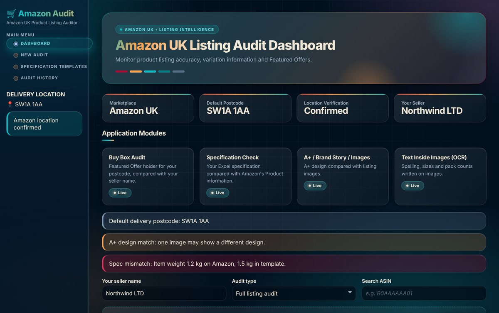
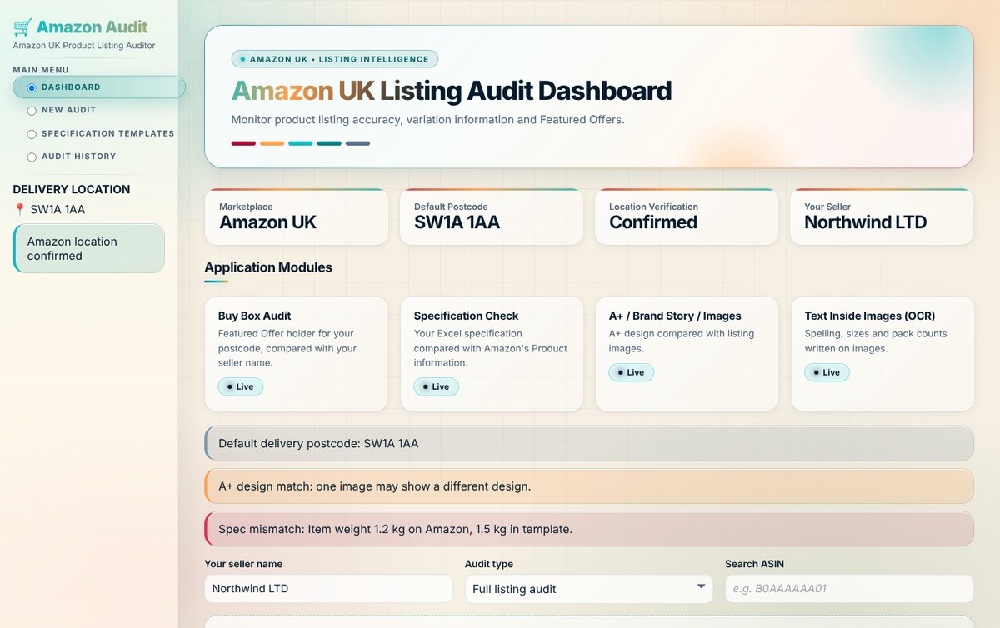
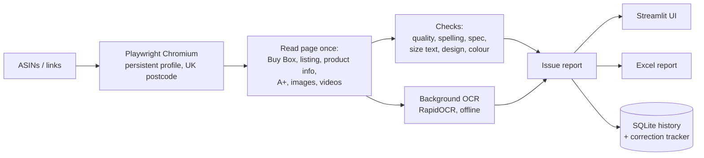

# Amazon Listing Audit Bot

**A local web app that audits Amazon UK product listings in bulk** — Buy Box ownership,
listing quality, product specifications, A+ content, images and the text printed on them —
and turns the results into one clear, trackable list of fixes.

Built for sellers who audit dozens of variations (sizes, colours, packs) by hand. Paste a
column of ASINs from Excel, press **Run Audit**, and get one row per product with everything
that is wrong, plus an Excel report.



<details>
<summary>Light theme</summary>



</details>

---

## What it checks

| Area | What the bot verifies |
|---|---|
| **Buy Box / Featured Offer** | Who holds the Featured Offer *for your delivery postcode*, compared with your seller name (`Your seller` / `Another seller` / `No featured offer` / `Not verified`). |
| **Delivery location** | Every product is read with your saved UK postcode. If Amazon forgets it, the bot sets it in Amazon's own "Deliver to" box. Results from a wrong location are never reported. |
| **Listing quality** | Amazon's title rules (200 characters, banned characters, promotional words, repeated words), bullet rules (special characters, emojis, guarantees, placeholders, duplicates), missing description, too few images. |
| **Specification check** | Your Excel template (per size, pieces and pack, e.g. `King 4 Piece`, `Double Pack of 2`) compared with Amazon's *Product information*, including collapsed sections. Units are converted (cm/mm/m/in, g/kg/oz/lb). Extra columns and text checks such as `Description contains`. |
| **Size text consistency** | The same size written the same way everywhere on the page and across all variation buttons — `King (220 x 230cm)` vs `King (220 x 230 cm)` is flagged. |
| **A+ content, Brand Story, images** | Displayed or missing; A+ images and product videos compared with the listing images to catch a different design. |
| **Colour check** | The colour on the page (e.g. *Navy*) is actually visible in the main images. |
| **Text inside images (OCR)** | Free, offline OCR reads listing and A+ images: British spelling, and sizes, piece counts, packs and dimensions printed on images compared with the product. |
| **British English** | Rule-based spelling for Amazon UK (e.g. *Microfiber → Microfibre*). |

## Workflow features

- **Batch audits** — paste up to 50 links or ASINs (a whole Excel column works).
- **Clear results** — one row per ASIN with every issue, severity levels (High / Medium / Low / Check / Advice), filters, and a *Copy for Excel* button.
- **Excel reports** — product results, all issues, spelling, specifications, content display and design checks.
- **Audit history** (SQLite) — every run saved; reopen or download any run.
- **Recheck** — re-audits a saved run and marks each issue *Verified fixed*, *Still present* or *New*.
- **Correction tracker** — a status for every finding (Not started → Verified fixed), kept across runs.
- **Support case assistant** — prepares case notes from findings (never submits anything).
- **Template builder** — builds a specification template (e.g. sheet `ES-DCS`) from a live
  listing family: one row per size variation from the Product information of several colours;
  where colours disagree, the majority value is used and the difference is noted.
- **Variation matrix** — reads every colour × size of a product family; choose a size (e.g. King) to audit all its packs, piece counts and colours, each against its own template row.
- **Liquid-glass interface** — Apple-inspired glassmorphism with dark and light themes, built on Streamlit.

## Speed

- One browser for the whole batch; each product page is loaded once and read once.
- The **next two products load in background tabs** while the current one is checked.
- Chrome runs **invisibly in the background** — no pop-up windows.
- Images are downloaded in parallel; OCR runs in a background thread.
- Every audit shows *where the time went* per step.

## How it works



The interface (`app.py`, `ui/`) only displays results. Browser work lives in `modules/`,
business logic in `services/`, reports in `reports/` and storage in `database/`. Checks are
pure functions with unit tests.

## Tech stack

Python · Streamlit · Playwright (Chromium) · SQLite · openpyxl · Pillow · NumPy ·
RapidOCR + ONNX Runtime · PowerShell / batch installers for Windows

## Install (Windows 10 / 11)

1. Download this repository (**Code → Download ZIP**) and unzip it.
2. Double-click **`Install Audit Bot.bat`** — it installs Python if needed, the libraries,
   the browser and OCR, and puts an **Amazon Audit Bot** icon on the desktop.
3. Double-click the desktop icon. The app opens in your browser.
4. First time: open **Delivery Location**, save your UK postcode and seller name, and click
   **Verify Location in Chrome**.

**Updating:** double-click **`Update Audit Bot.bat`** to get the latest version. Your settings,
audit history, templates and Amazon login stay on your computer and are never uploaded.

## Specification template

On **Specification Templates**, download the Excel template, fill one row per variation and
upload it:

| Product Type | Size | Item Weight | Thread Count | Fabric Type | Description contains |
|---|---|---|---|---|---|
| Duvet Cover Set | King 4 Piece | 1.5 kg | 400 | 100% Egyptian Cotton | 100% Egyptian Cotton |
| Fitted Sheet | Double Pack of 2 | 0.8 kg | 300 | Cotton | Deep pocket |

The bot picks the most specific row that matches what the product page shows.

- **Several sheets** — every sheet with *Product Type* and *Size* columns is read (e.g. one
  for fitted sheets, one for duvet cover sets).
- **Parts of a set** — columns such as *Fitted Sheet Dimensions* or *Fitted Sheet Pocket
  Depth* are compared with Amazon's field, or, when Amazon has none, with the measurement
  written next to "fitted sheet" / "pocket" in the title, bullets or description.
- **Measurements** — size names in values (`King (220 x 230 cm)`), a different number order or
  an extra depth on Amazon are handled; a weight written as `0.53G` (grams) is flagged when
  uploading, because it is almost always meant as kilograms.

## Tests

```bash
python -m unittest discover -s tests -t . -v
```

181 unit tests cover the checks, the issue report, history and rechecks, variation matching,
OCR checks (with a fake OCR engine) and the browser session logic (with fake pages) — no
internet needed.

## Responsible use

- Built to audit **your own** listings. Keep batches to a sensible size.
- Never bypasses CAPTCHA or any Amazon security check; it stops and reports instead.
- Never clicks basket, buy or offer buttons. The only page control it uses is Amazon's own
  delivery-location box.
- Personal data stays local: the browser profile (cookies), `config/settings.json`, the audit
  database and exports are excluded by `.gitignore`.

## Project structure

```
app.py                  Streamlit website (pages and navigation)
ui/                     Theme, results, specification, content and image-text screens
modules/                Amazon session, page readers, quality / size / spec / design / OCR checks
services/               Audit pipeline, batches, issue report, history, specifications
reports/                Excel reports
database/               SQLite storage and support cases
tests/                  Unit tests
Install / Start / Update / Publish *.bat   One-click Windows scripts
```

## Author

**Muhammad Shameer** — Computer Science student · [GitHub @M-Shameer](https://github.com/M-Shameer)
